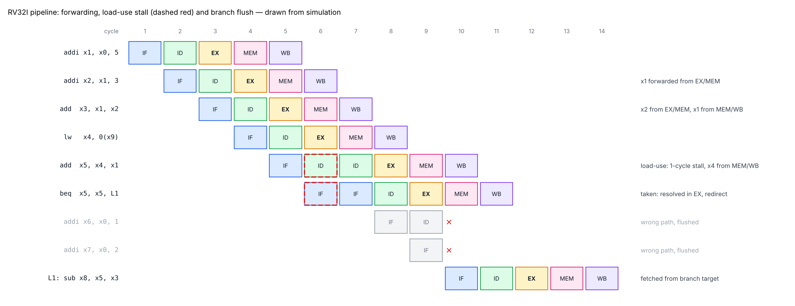
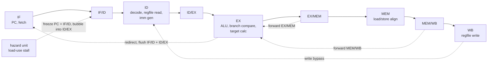

# RV32I 5-Stage Pipelined RISC-V Core in Verilog

[](https://github.com/tarunpratapsingh17/riscv-rv32i-pipeline/actions/workflows/sim.yml)

An in-order, 5-stage pipelined RISC-V processor implementing the full **RV32I**
base integer ISA plus **Zifencei**, with data forwarding, load-use hazard
detection and branch flushing. It passes the official **riscv-tests** RV32I
suite and runs compiled **C programs** (Fibonacci, sorting, matrix multiply,
sieve, CRC-32).



*Drawn from a simulation of `sw/asm/pipeline_demo.S`: back-to-back ALU
dependences are forwarded with no stall, a load followed by a dependent add
costs one stall cycle, and a taken branch resolved in EX flushes the two
wrong-path instructions behind it.*

---

## Highlights

- Full RV32I: all 37 computational, load/store, branch and jump instructions;
  FENCE.I flushes the pipeline (self-modifying code works); FENCE, ECALL,
  EBREAK and CSR instructions execute as NOPs
- Classic IF / ID / EX / MEM / WB pipeline with
  - forwarding from EX/MEM and MEM/WB into EX, plus a register-file write bypass
  - 1-cycle load-use stall
  - branches and jumps resolved in EX, static not-taken prediction (2-cycle taken penalty)
- Byte, half-word and word loads/stores with sign/zero extension
- **49/49 tests pass**: 41 official `rv32ui` riscv-tests, 2 directed tests, 6 C programs
- **Fault injection: 12/12** planted pipeline bugs are caught by the test suite
- Benchmark CPI 1.15 – 1.50 on compiled C code
- Verilator `-Wall` lint-clean; synthesizes to ~1,435 LUTs / 538 FFs on Xilinx 7-series (Yosys)
- GitHub Actions CI rebuilds every test from source and runs the full suite

## Microarchitecture



| File | Purpose |
|------|---------|
| `rtl/rv32i_core.v` | Pipeline registers and stage logic, top level of the core |
| `rtl/rv32i_decoder.v` | Main control decoder |
| `rtl/rv32i_imm_gen.v` | I / S / B / U / J immediates |
| `rtl/rv32i_alu.v` | ALU (add, sub, shifts, compares, logic) |
| `rtl/rv32i_regfile.v` | 32×32 register file, 2R/1W, x0 = 0, write bypass |
| `rtl/rv32i_hazard_unit.v` | Forwarding selects and load-use stall |
| `rtl/rv32i_lsu.v` | Store byte strobes, load extraction and extension |
| `rtl/rv32i_defs.vh` | Opcode / control encodings |

### Hazard handling

| Hazard | Example | How it is handled | Cost |
|--------|---------|-------------------|------|
| ALU result needed by next instruction | `addi x1,..` → `addi x2,x1,..` | Forward from EX/MEM | 0 cycles |
| Result needed two instructions later | `addi x1` → … → `add x3,x1,..` | Forward from MEM/WB | 0 cycles |
| Result needed three instructions later | written in WB, read in ID | Register-file write bypass | 0 cycles |
| Load result needed by next instruction | `lw x4` → `add x5,x4,..` | Stall 1 cycle, then forward from MEM/WB | 1 cycle |
| Taken branch / jump | `beq`, `jal`, `jalr` | Resolved in EX, flush IF/ID and ID/EX | 2 cycles |
| Self-modifying code | store → `fence.i` | `fence.i` re-fetches from pc+4 after the store has written | 2 cycles |

### Core interface

| Port | Description |
|------|-------------|
| `imem_addr` / `imem_rdata` | Instruction fetch (combinational read) |
| `dmem_addr`, `dmem_re`, `dmem_we`, `dmem_wstrb[3:0]`, `dmem_wdata` / `dmem_rdata` | Data access (combinational read, byte-strobed write) |
| `retire_valid`, `retire_pc`, `retire_instr` | One pulse per retired instruction (tracing, CPI) |
| `illegal_instr` | Unknown encoding reached EX |

## Verification

**Testbench** (`tb/tb_rv32i.v`): 64 KB memory loaded from a hex image, a
memory-mapped `TOHOST` register (pass/fail + failing test number) and a
`PUTCHAR` port for console output. It also fails on illegal instructions,
unmapped accesses, X on pipeline control signals and timeouts, and reports
cycles, retired instructions and CPI.

**Official riscv-tests** — all 41 `rv32ui` tests pass, run through a small
bare-metal environment (`sw/env/riscv_test.h`) that replaces the upstream
machine-mode one. `ma_data` is not run because misaligned accesses are not
supported.

**Directed tests** (`sw/asm/`)
- `fence_i_inline` — the patched instruction sits *directly* after `fence.i`,
  so it only executes correctly if FENCE.I really flushes (the official test
  reaches the patched code through a jump and cannot tell)
- `pipeline_demo` — forwarding, load-use stall and branch flush back to back

**C programs** (`sw/c/`, compiled with `gcc -O2 -march=rv32i`, self-checking)

| Program | What it exercises | Cycles | Instructions | CPI |
|---------|-------------------|-------:|-------------:|----:|
| `fib` | recursion, stack, call/return | 91,626 | 79,962 | 1.15 |
| `crc32` | shifts, XOR, byte loads (checks 0xCBF43926) | 883 | 683 | 1.29 |
| `matmul` | 8×8 integer matmul via libgcc `__mulsi3` | 151,088 | 109,660 | 1.38 |
| `sort` | insertion sort of 128 words, loads/stores | 45,774 | 31,411 | 1.46 |
| `primes` | sieve of Eratosthenes, byte stores | 23,682 | 15,805 | 1.50 |
| `hello` | console output via `PUTCHAR` | 298 | 173 | 1.72* |

\*dominated by pipeline fill and start-up code

### Fault injection — 12/12 bugs caught

`scripts/fault_injection.py` plants a bug into a copy of the RTL and re-runs the
suite; every mutation must make at least one test fail.

| Planted bug | First caught by |
|-------------|-----------------|
| No forwarding from EX/MEM | `rv32ui-add` |
| No forwarding from MEM/WB | `rv32ui-add` |
| No load-use stall | `rv32ui-lb` |
| Wrong-path instruction not flushed | `rv32ui-add` |
| Register-file write bypass removed | `rv32ui-add` |
| x0 not hard-wired to zero | `rv32ui-add` |
| SRA behaves like SRL | `rv32ui-lui` |
| BLTU uses a signed compare | `rv32ui-bltu` |
| LB zero-extends | `rv32ui-lb` |
| SH always writes the low half | `rv32ui-fence_i` |
| JAL/JALR link = pc instead of pc+4 | `rv32ui-auipc` |
| FENCE.I does not flush | `dir-fence_i_inline` |

The last row is why the directed `fence_i_inline` test exists: before it was
added, that bug survived the official suite.

## Synthesis

Yosys `synth_xilinx -family xc7` (core only, memories external):

| Resource | Count |
|----------|------:|
| LUTs | ~1,435 |
| Flip-flops | 538 |
| LUT RAM (register file) | 12 × RAM32M |
| CARRY4 | 66 |

## Running it

```bash
# all 49 tests with pre-built images (needs only Icarus Verilog)
python3 scripts/run_tests.py

# one test, printing every retired instruction
python3 scripts/run_tests.py c-fib --trace

# rebuild every test image from source
git clone https://github.com/riscv-software-src/riscv-tests third_party/riscv-tests
python3 scripts/build_tests.py

# check that the tests catch planted bugs
python3 scripts/fault_injection.py
```

Memory map used by the testbench: RAM `0x0000_0000 – 0x0000_FFFF`,
`TOHOST 0x0001_0000`, `PUTCHAR 0x0001_0004`. Programs start at `0x0`.

## Limitations and next steps

- No CSRs, exceptions or interrupts (machine mode would be the next step)
- Misaligned loads/stores are not supported
- Memories are read combinationally; mapping to FPGA block RAM needs a
  registered fetch stage
- Next: branch prediction (BTB + 2-bit counters), RV32M multiply/divide,
  instruction/data caches, and running on an FPGA board

## Repository layout

```
rtl/          core RTL
tb/           testbench
sw/env/       bare-metal environment + linker script for riscv-tests
sw/asm/       directed assembly tests
sw/c/         C programs, crt0, linker script
tests/hex/    pre-built memory images
scripts/      build, run, fault injection
docs/         pipeline diagram
```

## References

- *The RISC-V Instruction Set Manual, Volume I: Unprivileged ISA*
- D. A. Patterson and J. L. Hennessy, *Computer Organization and Design, RISC-V Edition*
- riscv-tests: https://github.com/riscv-software-src/riscv-tests

## License

MIT — see [LICENSE](LICENSE). Pre-built riscv-tests images are BSD-3-Clause,
see [tests/hex/LICENSE-riscv-tests](tests/hex/LICENSE-riscv-tests).
